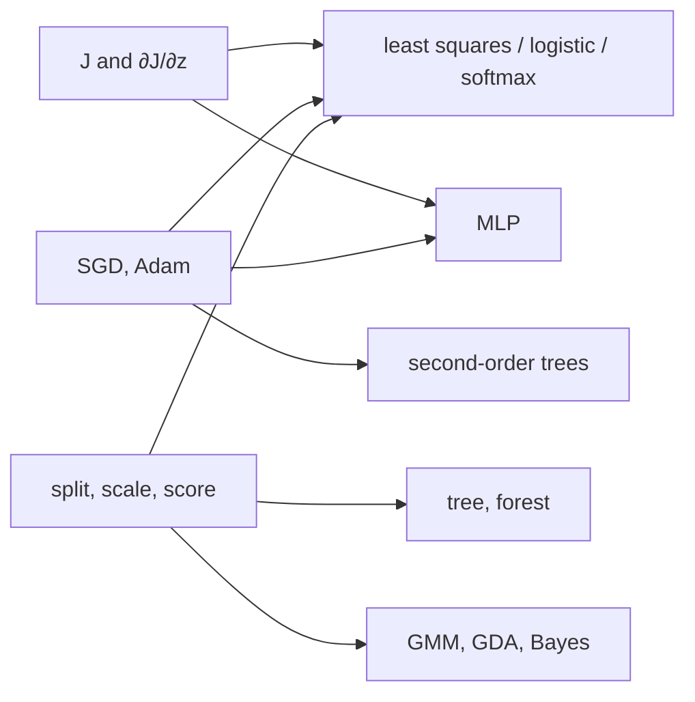

# ml_from_scratch

Estimators written in NumPy. Each one is the critical-point condition of an explicit objective. Parameters are obtained by setting a gradient to zero, solving a linear system, or maximizing a bound. No estimator delegates that step to another library.

Rows are samples and columns are features. $X\in\mathbb{R}^{m\times d}$. The target is either $y\in\mathbb{R}^{m}$ or a label in a finite set.

```text
ml_from_scratch/
├── optimization/        scalar losses and first-order steps
├── utils/               partitions, scaling, scores, K-fold
├── linear_models/       squared error, Bernoulli, softmax
├── tree_models/         impurity, bagging, second-order boosting
├── kernel_methods/      dual SVM, SMO
├── probabilistic/       GMM, GDA, naive Bayes
├── unsupervised/        Lloyd, PCA
└── neural_networks/     one hidden layer
```

The dependency runs one way. A loss is a scalar and exposes its derivative with respect to the prediction. An optimizer never evaluates the loss; it applies a supplied gradient in place. The model builds the chain rule through its own design matrix.



Dependency: `numpy`. Tests:

```text
python -m unittest discover -s tests -v
```

A single module runs on its own: `python tests/test_linear_models.py`.

---

## Objectives

Every empirical risk below is an average over the $m$ rows.

**Squared error.** Under $y\mid x\sim\mathcal N(x^\top\theta,\sigma^2)$, the negative log-likelihood in $\theta$ reduces to


$$
J=\frac{1}{2m}\lVert\hat y-y\rVert_2^2,
\qquad
\frac{\partial J}{\partial\hat y}=\frac{1}{m}(\hat y-y),
$$


up to a positive factor $1/\sigma^2$ and an additive constant. The factor $\tfrac12$ is the one in the Gaussian density, so the gradient is the averaged residual.

**Bernoulli likelihood in logit coordinates.** The probability-space gradient $(p-y)/(p(1-p))$ is unbounded as $p$ approaches the boundary. Writing $p=\sigma(z)$ cancels the sigmoid derivative against that denominator:


$$
J=\frac1m\sum_i\big(\mathrm{softplus}(z_i)-y_i z_i\big),
\qquad
\frac{\partial J}{\partial z}=\frac1m\big(\sigma(z)-y\big).
$$


**Softmax.** Scores $Z\in\mathbb{R}^{m\times K}$, one distribution per row.


$$
J=-\frac1m\sum_i\log p_{i,y_i},
\qquad
\frac{\partial J}{\partial Z}=\frac1m(P-Y).
$$


The average is over rows. Each row contributes one log-probability, not an average over classes. For $K=2$, if the free parameter is the difference of the two score columns, the criterion is Bernoulli cross-entropy.

**Hinge.** Labels in $\{\pm 1\}$.


$$
J=\frac1m\sum_i\max(0,\,1-y_i\hat y_i).
$$


The subgradient in the score is $-y_i/m$ on a violated margin and $0$ otherwise, including on the kink $y_i\hat y_i=1$.

**Steps.** Heavy ball:


$$
v_t=\mu v_{t-1}+g_t,\qquad \theta_t=\theta_{t-1}-\alpha v_t.
$$


Adam keeps exponential averages of the gradient and of its entrywise square, both started at zero. Division by $1-\beta^t$ removes that initialization bias. The step is preconditioned by the root second moment. Weight decay is not folded into $g_t$. It is subtracted in parameter space as $\alpha\lambda\theta$, so a coordinate with a small second moment is not shrunk beyond $\lambda$. A model that must leave an intercept unpenalized puts the masked $\lambda$ term in its own gradient and leaves the optimizer's `weight_decay` at zero.

---

## Linear models

**Squared loss.** The predictor is $h(x)=\theta_0+x^\top\theta_{1:}$. The leading column of the design is identically one, so the intercept is a coordinate of $\theta$. The penalty acts on slopes only: $P=\mathrm{diag}(0,1,\ldots,1)$.


$$
J(\theta)=\frac{1}{2m}\lVert X\theta-y\rVert_2^2+\frac{\lambda}{2m}\lVert P\theta\rVert_2^2.
$$


$$
\nabla J=\frac1m X^\top(X\theta-y)+\frac{\lambda}{m}P\theta,
\qquad
(X^\top X+\lambda P)\,\theta=X^\top y.
$$


The factor $1/m$ cancels when the gradient is set to zero. The same $\lambda$ is the coefficient in $\lVert X\theta-y\rVert_2^2+\lambda\lVert P\theta\rVert_2^2$. The normal equation forms the Gram matrix and solves it by LU. The inverse is not formed. The condition number of the Gram matrix is the square of the condition number of $X$. If that matrix is singular, or if its condition number exceeds $10^{12}$, the Moore–Penrose solution of the same system is returned. In exact arithmetic that vector is the minimum-norm minimizer. Gradient descent minimizes the same $J$ from the origin. A mini-batch re-averages only the data term, by $1/b$. The penalty gradient $(\lambda/m)P\theta$ is added in full on every step. Replacing $m$ by $b$ would scale $\lambda$ with the number of batches.

**Bernoulli.** The same mask $P$ and the same scaling of $\lambda$. The score is $z=x^\top\theta$ and the mean is $\sigma(z)$.


$$
\nabla J=\frac1m X^\top(p-y)+\frac{\lambda}{m}P\theta,
\qquad
\nabla^2 J=\frac1m X^\top S X+\frac{\lambda}{m}P,
\quad S=\mathrm{diag}\big(p(1-p)\big).
$$


$X^\top SX$ is the Gram matrix of the design after row $i$ is scaled by $\sqrt{p_i(1-p_i)}$. The $m\times m$ diagonal is never stored. The Newton step is


$$
\big(X^\top SX+\lambda P\big)^{-1}\big(X^\top(p-y)+\lambda P\theta\big).
$$


The step length starts at $1$. It is halved until the Armijo decrease test holds. With $\lambda=0$ and separable data the likelihood is unbounded and $\theta$ diverges.

**Softmax.** $\Theta\in\mathbb{R}^{d\times K}$ has one column per class and $Z=X\Theta$.


$$
\nabla_\Theta J=\frac1m X^\top(P_{\mathrm{prob}}-Y)+\frac{\lambda}{m}P\Theta.
$$


Adding one common vector to every column of $\Theta$ leaves the softmax unchanged, so the likelihood alone does not identify $\Theta$. The ridge term fixes that shift. For $K=2$ only $\theta_1-\theta_0$ enters the probability, and that difference is the weight of binary logistic regression. The Hessian is a $Kd\times Kd$ block matrix. Block $(k,\ell)$ is


$$
\frac1m X^\top\mathrm{diag}\big(p_k(\mathbf 1_{k=\ell}-p_\ell)\big)X.
$$


The implementation does not assemble that block matrix. It iterates the gradient above with SGD or Adam.

---

## Trees

Impurity at a node is a function of its class counts alone. $p_k=n_k/n$.


$$
G(p)=1-\sum_k p_k^2,
\qquad
H(p)=-\sum_k p_k\log_2 p_k,
\qquad
0\log 0:=0.
$$


$$
\mathrm{IG}=I(p)-\frac{n_L}{n}I(p_L)-\frac{n_R}{n}I(p_R).
$$


Under entropy this is the mutual information between the label and the left/right indicator. A change of log base multiplies every gain by the same positive constant, so the maximizing threshold is unchanged. After a column is sorted, the class counts to the left of every threshold are prefix sums of the label indicators. The loop runs over columns, because each column has its own order. It does not run over rows. The left branch is $x_j\le t$. A node with no positive gain remains a leaf. Every one-feature threshold on XOR has gain zero, so that pattern is a leaf.

**Forest.** Tree $b$ is grown on a multinomial bootstrap sample. The multiplicity of row $i$ is $\mathrm{Binomial}(n_b,1/n)$. A row drawn twice is two observations. In a draw of size $n$, the probability that a given row is excluded tends to $1/e$. The forest probability is the average of the leaf distributions:


$$
\hat P(y=k\mid x)=\frac1B\sum_{b=1}^B f_b(x)_k.
$$


For identically distributed trees with pairwise correlation $\rho$ and variance $\sigma^2$,


$$
\mathrm{Var}(\bar f)=\rho\sigma^2+\frac{1-\rho}{B}\sigma^2.
$$


As $B\to\infty$ the variance floors at $\rho\sigma^2$. Each node is offered $m_{\mathrm{try}}$ columns drawn without replacement. The default is $\lfloor\sqrt d\rfloor$. Information gain is maximized on that subset alone, which is what reduces $\rho$.

**Boosting.** Round $t$ fits a tree to the second-order expansion of the loss at the current prediction $F_{t-1}$. Derivatives are per row and are not divided by $m$. For $\lambda>0$, dividing both $G$ and $H$ by $m$ changes the leaf weight.

Squared loss $\ell=\tfrac12(y-F)^2$ has $g=F-y$ and $h=1$. Bernoulli loss in the logit has $g=\sigma(F)-y$ and $h=\sigma(F)(1-\sigma(F))$. The stored training loss is still the average, and it matches squared error and logit binary cross-entropy.


$$
w^\star=-\frac{G}{H+\lambda},
\qquad
\mathrm{Gain}=\frac12\left[\frac{G_L^2}{H_L+\lambda}+\frac{G_R^2}{H_R+\lambda}-\frac{G^2}{H+\lambda}\right]-\gamma.
$$


$$
F_t=F_{t-1}+\eta f_t.
$$


$\eta$ scales a finished tree. It does not enter the gain. For squared loss, $F_0=\bar y$, so the first root has gradient sum zero and leaf weight zero. Child sums need not vanish, so the first split can still have positive gain.

---

## Kernel

The soft-margin dual sees $\phi$ only through $K_{ij}=\phi(x_i)^\top\phi(x_j)$. Labels are in $\{\pm 1\}$.


$$
\max_\alpha\sum_i\alpha_i-\frac12\sum_{ij}\alpha_i\alpha_j y_i y_j K_{ij},
\quad 0\le\alpha_i\le C,\quad\sum_i\alpha_i y_i=0.
$$


$$
f(x)=\sum_i\alpha_i y_i K(x_i,x)+b.
$$


KKT: $\alpha_i=0\Rightarrow y_if\ge 1$, $0<\alpha_i<C\Rightarrow y_if=1$, $\alpha_i=C\Rightarrow y_if\le 1$.

SMO solves two multipliers exactly. The equality $y_i\Delta\alpha_i+y_j\Delta\alpha_j=0$ cuts a line through the box $[0,C]^2$.


$$
\eta=K_{ii}+K_{jj}-2K_{ij}=\lVert\phi(x_i)-\phi(x_j)\rVert^2,
\qquad
\alpha_j\leftarrow\Pi_{[L,H]}\!\left(\alpha_j+y_j\frac{E_i-E_j}{\eta}\right),
\quad E_t=f(x_t)-y_t.
$$


The kernels are $x^\top z$, $(\gamma x^\top z+r)^p$, and $\exp(-\gamma\lVert x-z\rVert^2)$. With `gamma="scale"`, $\gamma=1/(d\,\mathrm{Var}(X))$. The output is a signed margin. It is not a probability.

---

## Generative models

**Mixture.** $p(x)=\sum_k\pi_k\mathcal N(x\mid\mu_k,\Sigma_k)$. The observed log-likelihood has no closed maximizer. EM builds a lower bound from the responsibilities


$$
\log\gamma_{ik}=\log\pi_k+\log\mathcal N_{ik}-\log\sum_j\pi_j\mathcal N_{ij},
$$


then takes the weighted Gaussian MLE


$$
\pi_k=\frac{N_k}{n},\quad
\mu_k=\frac1{N_k}\sum_i\gamma_{ik}x_i,\quad
\Sigma_k=\frac1{N_k}\sum_i\gamma_{ik}(x_i-\mu_k)(x_i-\mu_k)^\top+\epsilon I.
$$


The mean is the row $\gamma_{\cdot k}^\top X/N_k$. The covariance is the Gram matrix of the centered rows after each row is scaled by $\sqrt{\gamma_{ik}}$. Initialization is a Lloyd partition.

**GDA.** $P(y=k)=\pi_k$ and $x\mid y=k\sim\mathcal N(\mu_k,\Sigma_k)$. The class score is the log joint density. Under a shared $\Sigma$, the term $x^\top\Sigma^{-1}x$ does not depend on $k$, and the score is linear:


$$
\delta_k(x)=x^\top\Sigma^{-1}\mu_k-\tfrac12\mu_k^\top\Sigma^{-1}\mu_k+\log\pi_k.
$$


The boundary belongs to the same family as softmax. The parameters do not: GDA maximizes $p(x,y)$, softmax maximizes $p(y\mid x)$. Separate covariances leave a quadratic boundary. The divisor in $\Sigma$ is $n$.

**Naive Bayes.** Coordinates are independent given the class. The emissions are a diagonal Gaussian, a Bernoulli coin for features in $\{0,1\}$, or a multinomial for nonnegative counts. The smoothed probabilities are


$$
\theta_{kj}=\frac{\text{sum of feature }j\text{ in class }k+\alpha}{\text{denominator}+\alpha\cdot c}.
$$


The Bernoulli denominator is $n_k+2\alpha$. The multinomial denominator is the class's total count plus $\alpha d$. The multinomial coefficient does not depend on $k$ and cancels in the posterior.

---

## Unsupervised

**Lloyd.** $J=\sum_i\lVert x_i-\mu_{c_i}\rVert^2$. With centers fixed, the label is the nearest center. With labels fixed, the center is the cluster mean. The square expands as


$$
\lVert x_i-y_j\rVert^2=\lVert x_i\rVert^2+\lVert y_j\rVert^2-2x_i^\top y_j
$$


and the assignment is one Gram matrix of shape $(n,K)$. The square root does not change the argmin. K-means++ draws the first center uniformly and each later center with probability proportional to squared distance from the centers already chosen. An empty center is moved to the row farthest from its assigned center.

**PCA.** Let $\bar x$ be the column mean and $X_c=X-1\bar x^\top$. The unbiased covariance is


$$
S=\frac{1}{n-1}X_c^\top X_c.
$$


The leading $r$ eigenvectors are the rows of $W$, and $Z=X_c W^\top$. Under this normalization $\lambda_k$ is the variance of column $k$ of $Z$. The ratio is $\lambda_k/\sum_j\lambda_j$.

The SVD $X_c=U\Sigma V^\top$ recovers the same axes, with $\lambda_k=\sigma_k^2/(n-1)$. It does not form $S$, so it does not square the condition number. The `eigen` path forms $S$ explicitly. The sign of each axis is fixed by making its largest-magnitude loading positive. Whitening divides coordinate $k$ by $\sqrt{\lambda_k}$.

---

## Network

One hidden layer:


$$
A=XW_1+1b_1^\top,\qquad
H=\varphi(A),\qquad
Z=HW_2+1b_2^\top.
$$


$\varphi$ is ReLU or the logistic sigmoid. Classification minimizes softmax cross-entropy in $Z$. Regression uses $K=1$ and squared error.


$$
\frac{\partial J}{\partial W_2}=H^\top G_Z,\qquad
G_A=\big(G_Z W_2^\top\big)\odot\varphi'(A),\qquad
\frac{\partial J}{\partial W_1}=X^\top G_A.
$$


$G_Z$ already contains the average over the rows it was evaluated on. The ReLU derivative is the indicator $a>0$. Each parameter array has its own SGD or Adam state, because the shapes differ and the moments cannot share one buffer. $\lambda$ is added only to the gradients of $W_1$ and $W_2$, as $(\lambda/m)W$.

---

## Scores and partitions

Accuracy is $\mathrm{tr}(C)/n$. Precision is $TP/(TP+FP)$, recall is $TP/(TP+FN)$, and $F_1$ is their harmonic mean. On a single-label problem, micro-averaged $F_1$ equals accuracy.


$$
R^2=1-\frac{\sum_i(y_i-\hat y_i)^2}{\sum_i(y_i-\bar y)^2}.
$$


ROC-AUC is the probability that a random positive receives a higher score than a random negative. Ties count as one half. The statistic is the Mann–Whitney form of the average rank of the positives.

Standardization uses the training column mean and the variance that divides by $n$. Held-out rows are mapped with that stored $(\mu,\sigma)$. A column with $\sigma=0$ is given scale $1$; after centering it is the zero vector.

K-fold partitions the $n$ indices into $K$ blocks whose sizes differ by at most one. The blocks are disjoint and their union is the full index set. If $y$ is supplied, each class is dealt round-robin across folds. `cross_val_score` refits the estimator on every training block and evaluates `score` on the held-out block. The estimator remains fitted on the last training block.
